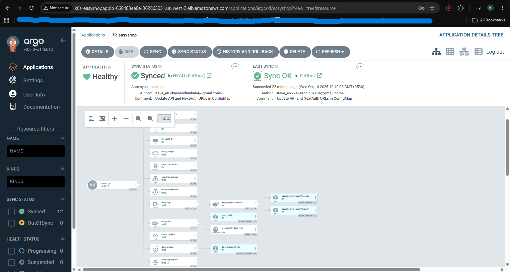
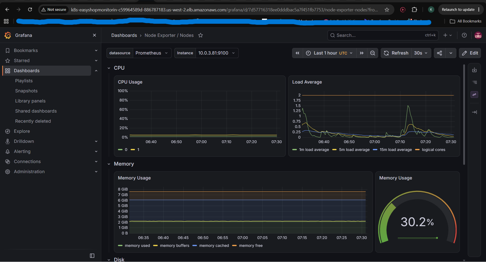
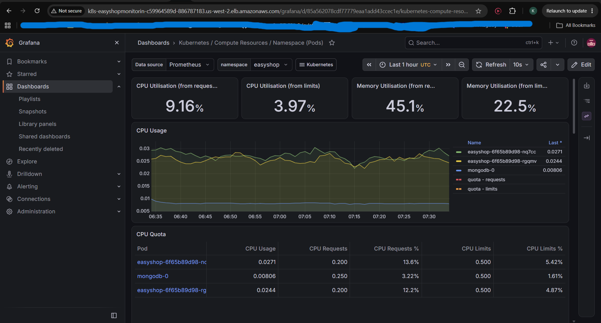
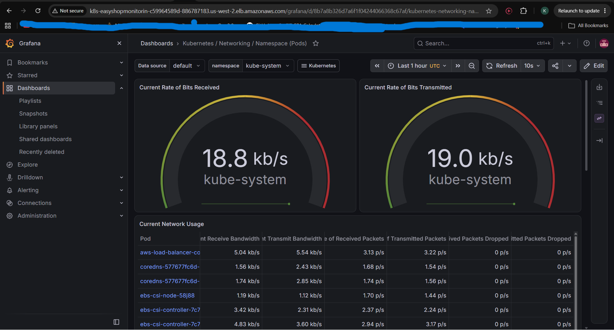
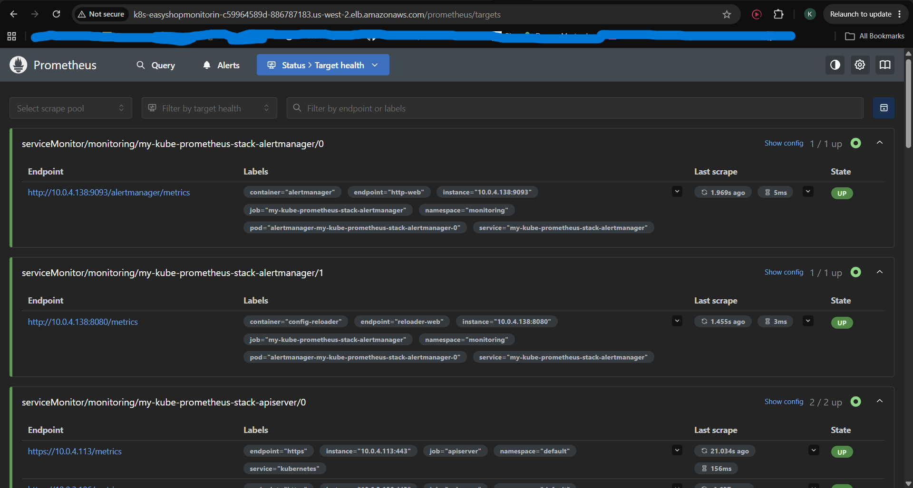
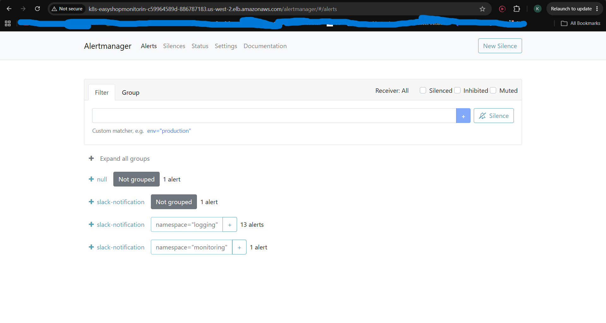
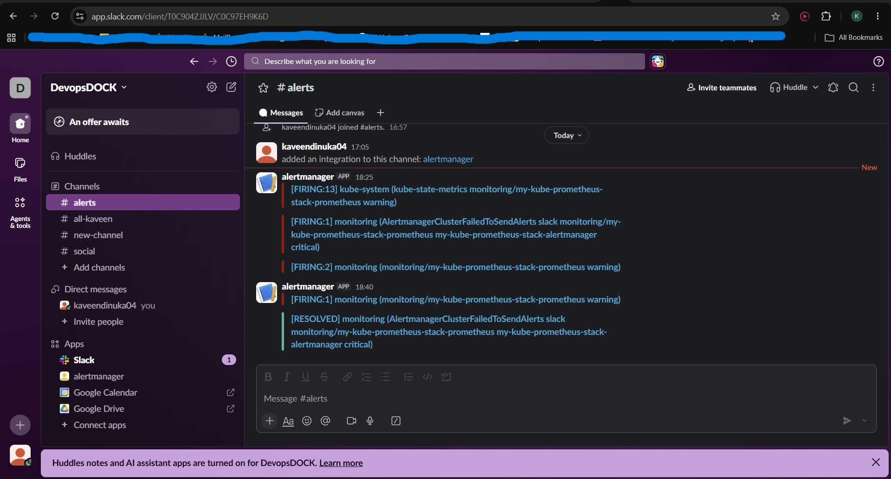

<div align="center">

# 🛍️ EasyShop on AWS EKS

### End-to-end DevOps deployment: Terraform · Jenkins · ArgoCD · Prometheus · Grafana · Slack


</div>

A 3-tier e-commerce application (**Next.js**, Node API routes, **MongoDB**) provisioned and deployed on **AWS EKS**, with a CI pipeline in Jenkins, GitOps delivery with ArgoCD, and monitoring with alerts sent to Slack.

> [!NOTE]
> **Credit:** forked from [LondheShubham153/tws-e-commerce-app](https://github.com/LondheShubham153/tws-e-commerce-app). The application, base Terraform, Jenkinsfile and Kubernetes manifests are by the original author. This repository documents how I **provisioned, adapted, deployed, monitored and operated** it on my own AWS account.

---

## 📑 Quick navigation

| | Section | | Section |
|---|---|---|---|
| 🏗️ | [Architecture](#architecture) | 🔧 | [Step-by-step build](#build) |
| 🧰 | [Tech stack](#stack) | 🛠️ | [What I adapted](#adapted) |
| 🔄 | [Project flow](#flow) | 🐞 | [Problems I solved](#problems) |
| 🧹 | [Teardown](#teardown) | 📸 | [Screenshots](#screenshots) |

---

<a id="architecture"></a>
## 🏗️ Architecture

```
Developer ──push──► GitHub ──webhook──► Jenkins EC2 (CI)
                       ▲                    │ build + push image
                       │                    ▼
                       │                Docker Hub
                       │
                       └── Jenkins commits the new image tag to kubernetes/ manifests
                       │
                       ▼
                 ArgoCD (in EKS) ── syncs Git ──► EKS cluster
                                                   ├─ easyshop (Next.js) pods
                                                   ├─ MongoDB StatefulSet
                                                   └─ Ingress ──► ALB ──► Users

Bastion EC2 : where kubectl, helm and aws commands are run against EKS
Monitoring  : Prometheus ─► Alertmanager ─► Slack,  Grafana dashboards
```

### 🌐 Network layout (created by Terraform)

```
VPC 10.0.0.0/16
├── us-west-2a
│   ├── 🌍 Public  subnet 10.0.1.0/24  → ALB node, NAT gateway (Elastic IP), Bastion
│   └── 🔒 Private subnet 10.0.3.0/24  → EKS worker node (pods)
└── us-west-2b
    ├── 🌍 Public  subnet 10.0.2.0/24  → ALB node
    └── 🔒 Private subnet 10.0.4.0/24  → EKS worker node (pods)

Internet Gateway → public route table
NAT Gateway      → private route table (outbound only)
```

| Piece | Role in this project |
|---|---|
| 🏠 **VPC** | Isolated network that contains everything |
| 🌍 **Public subnets** | Host the ALB, Bastion and NAT gateway |
| 🔒 **Private subnets** | Host the EKS worker nodes and pods, so the app is not directly exposed |
| 🚪 **Internet Gateway** | Two-way door between the VPC and the internet |
| 📮 **NAT gateway** | Lets private nodes pull images and send alerts, outbound only |
| 🏷️ **Subnet tags** | `kubernetes.io/role/elb=1` (public) and `kubernetes.io/role/internal-elb=1` (private) tell the Load Balancer Controller where to place load balancers |

---

<a id="stack"></a>
## 🧰 Tech stack

| Area | Tools |
|---|---|
| ☁️ Cloud | AWS (VPC, EKS, EC2, ALB, NAT Gateway, IAM, S3, KMS) |
| 🏗️ Infrastructure as Code | Terraform with S3 remote state |
| 🔨 CI | Jenkins (shared library, SCM pipeline, GitHub webhook), unit tests, Trivy image scan |
| 🚀 CD / GitOps | ArgoCD |
| 📦 Packaging | Helm |
| 🐳 Containers | Docker, Docker Hub |
| ☸️ Orchestration | Kubernetes (EKS 1.31) |
| 🌍 Ingress | AWS Load Balancer Controller (ALB) |
| 💾 Storage | EBS CSI driver |
| 📊 Monitoring and alerting | kube-prometheus-stack (Prometheus, Grafana, Alertmanager), Slack |
| 🛒 App | Next.js 14, TypeScript, MongoDB |

---

<a id="flow"></a>
## 🔄 Project flow

| # | What happens | Tool |
|---|---|---|
| 1️⃣ | Terraform builds the VPC, EKS cluster, node group, Jenkins EC2 and Bastion EC2 | Terraform |
| 2️⃣ | A push to GitHub triggers Jenkins through a webhook | GitHub, Jenkins |
| 3️⃣ | Jenkins builds the app and migration images, runs unit tests and a Trivy scan, pushes the images to Docker Hub, and commits the new image tag to the Kubernetes manifests in Git | Jenkins, Docker |
| 4️⃣ | ArgoCD detects the change in Git and syncs it to the EKS cluster | ArgoCD |
| 5️⃣ | The Load Balancer Controller creates an ALB from the Ingress and sends traffic to the pods | AWS LB Controller |
| 6️⃣ | Prometheus collects metrics, Grafana visualizes them, Alertmanager sends alerts to Slack | kube-prometheus-stack |

> [!TIP]
> No manual `kubectl apply` is used for the application. **Git is the single source of truth.**

---

<a id="build"></a>
## 🔧 Step-by-step build

### 🧱 Step 0 · Prerequisites

- ✅ AWS account and an IAM user with programmatic access
- ✅ Tools on my laptop: Terraform, AWS CLI, Git
- ✅ Docker Hub account and a GitHub account
- ✅ Forked the application repo and the Jenkins shared-library repo

```bash
aws configure          # region: us-west-2

ssh-keygen -f terra-key   # SSH key for the EC2 instances (never committed to Git)
chmod 400 terra-key
```

---

### 🏗️ Step 1 · Provision the infrastructure with Terraform

Files in `terraform/`: `provider.tf`, `terraform.tf`, `vpc.tf`, `eks.tf`, `ec2.tf`, `bastion_ec2.tf`, `variables.tf`, `outputs.tf`. State is stored in an **S3 bucket** (with lockfile) configured in `terraform.tf`.

```bash
cd terraform
terraform init
terraform plan
terraform apply
```

This created about **65 resources**:

| Group | What was created |
|---|---|
| 🌐 Network | VPC, 2 public and 2 private subnets across 2 AZs, Internet Gateway, NAT Gateway with an Elastic IP, route tables |
| ☸️ EKS | Cluster `tws-eks-cluster`, KMS key, OIDC provider (for IAM roles for service accounts), add-ons (CoreDNS, kube-proxy, VPC CNI), managed node group of `t3.large` nodes |
| 🔨 Jenkins EC2 | Instance with an Elastic IP, bootstrapped by `install_tools.sh` |
| 🖥️ Bastion EC2 | Instance bootstrapped by `bastion_user_data.sh` |
| 🔐 Security | Security groups and an SSH key pair |

📤 Outputs: cluster name, VPC ID, public IPs.

---

### 🔨 Step 2 · Set up Jenkins (CI) on the Jenkins EC2

**1. Unlock Jenkins** at `http://<jenkins-ip>:8080`:

```bash
sudo cat /var/lib/jenkins/secrets/initialAdminPassword
```

**2. Install plugins:** `Docker Pipeline` and `Pipeline View`.

**3. Add global credentials** (Manage Jenkins → Credentials):

| 🔑 Credential ID | Type | Used for |
|---|---|---|
| `github-credentials` | Username + token (GitHub user `KaveenAlahapperuma`) | Cloning the repo and pushing the manifest update |
| `docker-hub-credentials` | Username + token (Docker Hub user `kaveend4`) | Pushing images to Docker Hub |

**4. Configure the shared library** (Manage Jenkins → System → Global Pipeline Libraries):

| Setting | Value |
|---|---|
| Name | `Shared` |
| Default version | `main` |
| Repository | `https://github.com/KaveenAlahapperuma/jenkins-shared-libraries.git` |

**5. Updated my forks:** replaced the Docker Hub username in the `Jenkinsfile` and in `vars/update_k8s_manifest.groovy`.

**6. Created the pipeline job `EasyShop`:**

| Setting | Value |
|---|---|
| Type | Pipeline |
| GitHub project URL | `https://github.com/KaveenAlahapperuma/e-commerce-app.git` |
| Trigger | GitHub hook trigger for GITScm polling |
| Definition | Pipeline script from SCM |
| SCM | Git, my app fork, `github-credentials`, branch `master` |
| Script path | `Jenkinsfile` |

**7. Added a GitHub webhook:** `http://<jenkins-ip>:8080/github-webhook/`

**8. Ran ▶️ Build Now.**

#### 📋 Pipeline stages

The `Jenkinsfile` loads the shared library with `@Library('Shared') _`. The image tag is the Jenkins `BUILD_NUMBER`.

| # | Stage | What it does |
|---|---|---|
| 1 | 🧹 Cleanup Workspace | Clears the Jenkins workspace (`clean_ws`) |
| 2 | 📥 Clone Repository | Clones my fork of the app repo, branch `master` (`clone`) |
| 3 | 🐳 Build Docker Images *(parallel)* | Builds the main app image (`Dockerfile`) and the migration image (`scripts/Dockerfile.migration`) with `docker_build` |
| 4 | 🧪 Run Unit Tests | Runs the application tests (`run_tests`) |
| 5 | 🛡️ Security Scan with Trivy | Scans the images for vulnerabilities (`trivy_scan`) |
| 6 | 📤 Push Docker Images *(parallel)* | Pushes both images to Docker Hub with `docker-hub-credentials` (`docker_push`) |
| 7 | ✏️ Update Kubernetes Manifests | Writes the new image tag into the manifests under `kubernetes/`, then commits and pushes to Git with `github-credentials` (`update_k8s_manifests`) |

> [!NOTE]
> **Result of CI:** two new images in Docker Hub and a Git commit with the new image tag. Jenkins never touches the cluster; ArgoCD picks up the commit.

---

### 🖥️ Step 3 · Configure the Bastion host (CD host)

The Bastion is the instance used to manage EKS. It is separate from the Jenkins server.

```bash
ssh -i terra-key ubuntu@<bastion-ip>

aws configure
aws eks update-kubeconfig --region us-west-2 --name tws-eks-cluster
kubectl get nodes
```

Installed the tools used in the next steps: `kubectl`, `helm`, `eksctl`.

<details>
<summary>🔓 If <code>kubectl</code> says "must be logged in to the server"</summary>

Grant my IAM user access to the cluster with an EKS access entry:

```bash
aws eks create-access-entry --cluster-name tws-eks-cluster --region us-west-2 \
  --principal-arn arn:aws:iam::<ACCOUNT_ID>:user/<IAM_USER>

aws eks associate-access-policy --cluster-name tws-eks-cluster --region us-west-2 \
  --principal-arn arn:aws:iam::<ACCOUNT_ID>:user/<IAM_USER> \
  --policy-arn arn:aws:eks::aws:cluster-access-policy/AmazonEKSClusterAdminPolicy \
  --access-scope type=cluster
```

</details>

---

### ⚖️ Step 4 · Install the AWS Load Balancer Controller

It converts Kubernetes **Ingress** resources into AWS **Application Load Balancers**.

```bash
# IAM policy for the controller
curl -O https://raw.githubusercontent.com/kubernetes-sigs/aws-load-balancer-controller/v2.14.1/docs/install/iam_policy.json
aws iam create-policy \
  --policy-name AWSLoadBalancerControllerIAMPolicy \
  --policy-document file://iam_policy.json

# Confirm the cluster's OIDC provider exists
aws eks describe-cluster --name tws-eks-cluster --region us-west-2 \
  --query 'cluster.identity.oidc.issuer' --output text
aws iam list-open-id-connect-providers

# Service account with an IAM role (IRSA)
eksctl create iamserviceaccount \
  --cluster=tws-eks-cluster \
  --namespace=kube-system \
  --name=aws-load-balancer-controller \
  --attach-policy-arn=arn:aws:iam::<ACCOUNT_ID>:policy/AWSLoadBalancerControllerIAMPolicy \
  --override-existing-serviceaccounts \
  --region us-west-2 \
  --approve

# Install with Helm, using the cluster's actual VPC ID
VPC_ID=$(aws eks describe-cluster --name tws-eks-cluster --region us-west-2 \
  --query 'cluster.resourcesVpcConfig.vpcId' --output text)

helm repo add eks https://aws.github.io/eks-charts
helm repo update eks

helm install aws-load-balancer-controller eks/aws-load-balancer-controller \
  -n kube-system \
  --set clusterName=tws-eks-cluster \
  --set serviceAccount.create=false \
  --set serviceAccount.name=aws-load-balancer-controller \
  --set region=us-west-2 \
  --set vpcId=$VPC_ID \
  --version 1.14.0

kubectl get deployment -n kube-system aws-load-balancer-controller
```

> [!WARNING]
> Always pass the **cluster's real VPC ID** and pin the chart `--version`. A stale VPC ID caused my biggest bug (see [Problems I solved](#problems)).

---

### 💾 Step 5 · Install the EBS CSI driver

```bash
# IAM role for the driver (role only; the service account comes from the Helm chart)
eksctl create iamserviceaccount \
  --name ebs-csi-controller-sa \
  --namespace kube-system \
  --cluster tws-eks-cluster \
  --region us-west-2 \
  --role-name AmazonEKS_EBS_CSI_DriverRole \
  --role-only \
  --attach-policy-arn <AWS-managed EBS CSI driver policy ARN> \
  --approve

helm repo add aws-ebs-csi-driver https://kubernetes-sigs.github.io/aws-ebs-csi-driver
helm repo update aws-ebs-csi-driver
helm install aws-ebs-csi-driver aws-ebs-csi-driver/aws-ebs-csi-driver -n kube-system

# Attach the role to the driver's service account
kubectl annotate sa ebs-csi-controller-sa -n kube-system \
  eks.amazonaws.com/role-arn=arn:aws:iam::<ACCOUNT_ID>:role/AmazonEKS_EBS_CSI_DriverRole --overwrite
kubectl rollout restart deployment ebs-csi-controller -n kube-system

kubectl get pods -n kube-system | grep ebs     # controller pods should be 5/5 Running
```

---

### 🚀 Step 6 · Install ArgoCD with Helm

Created `argocd-values.yaml` containing **only my changes**:

```yaml
global:
  domain: ""

configs:
  params:
    server.insecure: true

server:
  ingress:
    enabled: true
    controller: aws
    ingressClassName: alb
    hostname: ""
    annotations:
      alb.ingress.kubernetes.io/scheme: internet-facing
      alb.ingress.kubernetes.io/group.name: easyshop-app-lb
      alb.ingress.kubernetes.io/target-type: ip
      alb.ingress.kubernetes.io/backend-protocol: HTTP
      alb.ingress.kubernetes.io/listen-ports: '[{"HTTP":80}]'
    aws:
      serviceType: ClusterIP
      backendProtocolVersion: HTTP1
```

```bash
helm repo add argo https://argoproj.github.io/argo-helm
helm repo update argo

helm install my-argo-cd argo/argo-cd \
  -n argocd --create-namespace \
  -f argocd-values.yaml \
  --version 8.0.10

kubectl get pods -n argocd
kubectl get ingress -n argocd          # ALB address appears in 1-3 minutes
```

Open `http://<ALB-ADDRESS>` and log in as `admin`:

```bash
kubectl get secret argocd-initial-admin-secret -n argocd \
  -o jsonpath="{.data.password}" | base64 -d; echo
```

Then change the admin password under **User Info** and delete the initial secret:

```bash
kubectl delete secret argocd-initial-admin-secret -n argocd
```

---

### 📈 Step 7 · Install metrics-server

```bash
helm repo add metrics-server https://kubernetes-sigs.github.io/metrics-server/
helm install my-metrics-server metrics-server/metrics-server
kubectl top pods
```

---

### 🛒 Step 8 · Deploy the application through ArgoCD

Edited the manifests in my fork's `kubernetes/` folder (see [What I adapted](#adapted)), committed and pushed. Then in the ArgoCD UI, clicked **New App**:

| Field | Value |
|---|---|
| Project | `default` |
| Sync policy | Automatic |
| Repository URL | my fork |
| Revision | `main` |
| Path | `kubernetes` |
| Cluster URL | `https://kubernetes.default.svc` |
| Namespace | `easyshop` (auto-create) |

ArgoCD applied the **12 manifests**:

| Files | Resources |
|---|---|
| `01` | Namespace |
| `02` - `03` | MongoDB PV and PVC |
| `04` - `05` | ConfigMap and Secret |
| `06` - `07` | MongoDB Service and StatefulSet |
| `08` - `09` | App Deployment and Service |
| `10` | Ingress |
| `11` | HPA |
| `12` | Database migration Job |

```bash
kubectl get pods,pvc,ingress -n easyshop
```

✅ Expected: PVC `Bound`, MongoDB and 2 app pods `Running`, migration Job `Completed`, and an ALB address on the Ingress.

After putting the ALB address into the ConfigMap URLs, restart the app:

```bash
kubectl rollout restart deployment easyshop -n easyshop
```

🎉 Opened the ALB address in the browser to use the shop.

---

### 📊 Step 9 · Monitoring and alerting

```bash
kubectl create namespace monitoring
helm repo add prometheus-community https://prometheus-community.github.io/helm-charts
helm repo update prometheus-community

helm install my-kube-prometheus-stack prometheus-community/kube-prometheus-stack \
  -n monitoring -f kube-prom-stack.yaml
```

`kube-prom-stack.yaml` puts **Grafana, Prometheus and Alertmanager behind one ALB** using path-based routing:

<details>
<summary>📄 Click to view the key parts of <code>kube-prom-stack.yaml</code></summary>

```yaml
grafana:
  grafana.ini:
    server:
      root_url: "%(protocol)s://%(domain)s/grafana/"
      serve_from_sub_path: true
  ingress:
    enabled: true
    ingressClassName: alb
    annotations:
      alb.ingress.kubernetes.io/group.name: easyshop-monitoring
      alb.ingress.kubernetes.io/scheme: internet-facing
      alb.ingress.kubernetes.io/target-type: ip
      alb.ingress.kubernetes.io/backend-protocol: HTTP
      alb.ingress.kubernetes.io/listen-ports: '[{"HTTP":80}]'
      alb.ingress.kubernetes.io/healthcheck-path: /grafana/api/health
    hosts: []
    path: /grafana
    pathType: Prefix

prometheus:
  ingress:
    enabled: true
    ingressClassName: alb
    annotations:
      alb.ingress.kubernetes.io/group.name: easyshop-monitoring
      alb.ingress.kubernetes.io/scheme: internet-facing
      alb.ingress.kubernetes.io/target-type: ip
      alb.ingress.kubernetes.io/backend-protocol: HTTP
      alb.ingress.kubernetes.io/listen-ports: '[{"HTTP":80}]'
      alb.ingress.kubernetes.io/healthcheck-path: /prometheus/-/healthy
    hosts: []
    paths:
      - /prometheus
    pathType: Prefix
  prometheusSpec:
    routePrefix: /prometheus
    externalUrl: http://<MONITORING-ALB-ADDRESS>/prometheus

alertmanager:
  ingress:
    enabled: true
    ingressClassName: alb
    annotations:
      alb.ingress.kubernetes.io/group.name: easyshop-monitoring
      alb.ingress.kubernetes.io/scheme: internet-facing
      alb.ingress.kubernetes.io/target-type: ip
      alb.ingress.kubernetes.io/backend-protocol: HTTP
      alb.ingress.kubernetes.io/listen-ports: '[{"HTTP":80}]'
      alb.ingress.kubernetes.io/healthcheck-path: /alertmanager/-/healthy
    hosts: []
    paths:
      - /alertmanager
    pathType: Prefix
  alertmanagerSpec:
    routePrefix: /alertmanager

# EKS does not expose these control-plane components
kubeEtcd:
  enabled: false
kubeControllerManager:
  enabled: false
kubeScheduler:
  enabled: false
kubeProxy:
  enabled: false
```

</details>

Install once, read the ALB address (`kubectl get ingress -n monitoring`), put it into `externalUrl`, then upgrade (pin the chart version shown by `helm list -n monitoring`):

```bash
helm upgrade my-kube-prometheus-stack prometheus-community/kube-prometheus-stack \
  -n monitoring -f kube-prom-stack.yaml --version <chart-version>
```

🔗 **Access:**

| Tool | URL | Login |
|---|---|---|
| 📊 Grafana | `http://<ALB>/grafana` | `admin` + password from the secret below |
| 🔥 Prometheus | `http://<ALB>/prometheus` | none |
| 🚨 Alertmanager | `http://<ALB>/alertmanager` | none |

```bash
kubectl get secret my-kube-prometheus-stack-grafana -n monitoring \
  -o jsonpath="{.data.admin-password}" | base64 -d; echo
```

#### 💬 Slack alerts

1. Created a Slack workspace and an `#alerts` channel.
2. At [api.slack.com/apps](https://api.slack.com/apps), created an app, enabled **Incoming Webhooks**, and added a webhook for `#alerts`.
3. Added the Alertmanager config to `kube-prom-stack.yaml`:

> [!WARNING]
> The webhook URL is a secret. Never commit it to Git.

<details>
<summary>📄 Click to view the Alertmanager config</summary>

```yaml
alertmanager:
  config:
    global:
      resolve_timeout: 5m
    route:
      group_by: ['alertname', 'namespace']
      group_wait: 30s
      group_interval: 5m
      repeat_interval: 12h
      receiver: 'slack-notification'
      routes:
        - receiver: 'null'
          matchers:
            - alertname =~ "Watchdog|InfoInhibitor"
        - receiver: 'slack-notification'
          matchers:
            - severity =~ "critical|warning"
    receivers:
      - name: 'null'
      - name: 'slack-notification'
        slack_configs:
          - api_url: '<SLACK_WEBHOOK_URL>'
            channel: '#alerts'
            send_resolved: true
            title: '[{{ .Status | toUpper }}] {{ .CommonLabels.alertname }}'
            text: >-
              {{ range .Alerts }}
              *Severity:* {{ .Labels.severity }}
              *Namespace:* {{ .Labels.namespace }}
              *Summary:* {{ .Annotations.summary }}
              {{ end }}
```

</details>

4. Applied with `helm upgrade`, then tested with a manual alert:

```bash
kubectl port-forward svc/my-kube-prometheus-stack-alertmanager -n monitoring 9093:9093 &

curl -XPOST http://localhost:9093/alertmanager/api/v2/alerts \
  -H "Content-Type: application/json" \
  -d '[{"labels":{"alertname":"TestAlert","severity":"critical","namespace":"easyshop"},"annotations":{"summary":"Test alert from Alertmanager"}}]'
```

✅ The alert arrived in the `#alerts` Slack channel.

📊 **Grafana dashboards used:** Node Exporter / Nodes, Kubernetes / Compute Resources (Workload, Namespace), and Prometheus / Overview.

---

<a id="adapted"></a>
## 🛠️ What I adapted

| Area | Change |
|---|---|
| 🌍 Ingress (app, ArgoCD, monitoring) | Configured as HTTP ALB ingresses reached through the ALB DNS name; separate ALB groups so host-less `/` rules do not collide |
| 🚀 ArgoCD values | Small values file with only my changes; `global.domain` cleared so the Ingress matches any host |
| 💾 MongoDB PVC | Added `storageClassName: ""` and `volumeName: mongodb-pv` so it binds to the `hostPath` volume instead of waiting for a dynamically provisioned EBS volume |
| ⚙️ ConfigMap | `NEXTAUTH_URL` and `NEXT_PUBLIC_API_URL` set to the app's ALB address (second pass after the ALB exists) |
| 📊 Monitoring | Path-based routing (`/grafana`, `/prometheus`, `/alertmanager`) behind one ALB, with `routePrefix`, `externalUrl` and Grafana sub-path settings |
| 🚨 Alerting | Slack receiver, `Watchdog` routed to a null receiver, severity routing |
| 📌 Helm versions | Chart versions pinned on every upgrade |

---

<a id="problems"></a>
## 🐞 Problems I solved

| # | Problem | Symptom | Root cause | Fix |
|---|---|---|---|---|
| 1 | 🔒 **Locked out of the cluster** | `kubectl`: "must be logged in to the server" even though my IAM user created the cluster | No EKS access entry for my user; the access list held an unrelated principal | Found the creator in CloudTrail, listed access entries, created an entry for my user with `AmazonEKSClusterAdminPolicy` |
| 2 | 🌐 **ALB could not reach pods** | Page would not load; controller logs showed `InvalidGroup.NotFound: two resources that belong to different networks` | The load balancer controller had a **stale VPC ID** from an earlier build, so the ALB and its security group were created in the wrong VPC | Compared the cluster VPC with the controller's `vpcId`, upgraded the controller with the correct ID, deleted the orphaned ALB, target groups and security group, then redeployed |
| 3 | 📦 **Helm upgrade failed** | `nil pointer evaluating interface {}.defaultPCAARN` | `--reuse-values` combined with a newer chart version | Pinned `--version` to the installed chart |
| 4 | 🚀 **ArgoCD reinstall failed** | `invalid ownership metadata` on CRDs | Leftover CRDs owned by a release in another namespace | Deleted the unused CRDs and reinstalled into the `argocd` namespace |
| 5 | 🔥 **Prometheus broken behind the ALB** | Grafana and Alertmanager worked, Prometheus did not | Default `externalUrl` was the internal service address | Set `externalUrl` to the ALB URL with `/prometheus`, together with `routePrefix` |
| 6 | 💾 **EBS CSI controller crash-looping** | `CrashLoopBackOff`; logs: "no EC2 IMDS role found"; PVCs `Pending` | The IAM role existed but the service account was missing the `eks.amazonaws.com/role-arn` annotation | Annotated the service account with the role ARN and restarted; verified `AWS_ROLE_ARN` was injected into the pods |
| 7 | 📄 **Invalid YAML values file** | `did not find expected key` | `annotations: {}` left in place above a list of keys | Replaced the large default file with a small values file of only my changes |

---

<a id="teardown"></a>
## 🧹 Teardown

> [!IMPORTANT]
> **Order matters:** the load balancer controller must delete the ALBs **before** Terraform destroys the VPC.

**1️⃣ Remove workloads** (this also removes their ALBs):

```bash
kubectl delete application --all -n argocd
kubectl delete namespace easyshop
helm uninstall my-kube-prometheus-stack -n monitoring && kubectl delete namespace monitoring
helm uninstall my-argo-cd -n argocd && kubectl delete namespace argocd
helm uninstall my-metrics-server
```

**2️⃣ Confirm the ALBs and target groups are gone** (both should print `[]`):

```bash
aws elbv2 describe-load-balancers --region us-west-2 --query 'LoadBalancers[].LoadBalancerName'
aws elbv2 describe-target-groups  --region us-west-2 --query 'TargetGroups[].TargetGroupName'
```

**3️⃣ Remove the controllers and manually created IAM resources:**

```bash
helm uninstall aws-load-balancer-controller -n kube-system
helm uninstall aws-ebs-csi-driver -n kube-system
eksctl delete iamserviceaccount --cluster tws-eks-cluster --region us-west-2 \
  --namespace kube-system --name aws-load-balancer-controller
aws iam detach-role-policy --role-name AmazonEKS_EBS_CSI_DriverRole --policy-arn <attached-policy-arn>
aws iam delete-role --role-name AmazonEKS_EBS_CSI_DriverRole
aws iam delete-policy --policy-arn arn:aws:iam::<ACCOUNT_ID>:policy/AWSLoadBalancerControllerIAMPolicy
```

**4️⃣ Check for leftover controller-created security groups:**

```bash
aws ec2 describe-security-groups --region us-west-2 \
  --filters Name=vpc-id,Values=<VPC_ID> \
  --query 'SecurityGroups[?starts_with(GroupName,`k8s-`)].GroupId'
```

**5️⃣ Destroy the infrastructure** (from the machine that holds the Terraform state):

```bash
terraform destroy
```

**6️⃣ Final cost check for leftovers that keep billing:**

```bash
aws eks list-clusters --region us-west-2
aws ec2 describe-nat-gateways --region us-west-2 --filter Name=state,Values=available
aws ec2 describe-addresses --region us-west-2
aws ec2 describe-vpcs --region us-west-2
aws ec2 describe-instances --region us-west-2 --query "Reservations[].Instances[?State.Name=='running'].InstanceId"
```

---

<a id="screenshots"></a>
## 📸 Screenshots

### 🛒 Application and GitOps

| EasyShop running on EKS | ArgoCD: Synced and Healthy |
|---|---|
|  |  |

### 📊 Monitoring

| Grafana: Node Exporter / Nodes | Grafana: Compute Resources, `easyshop` namespace |
|---|---|
|  |  |

| Grafana: Networking / Namespace (Pods) | Prometheus: target health |
|---|---|
|  |  |

### 🚨 Alerting

| Alertmanager | Slack `#alerts` |
|---|---|
|  |  |

---

## 🔐 Security notes

Never commit: `terra-key` (private key), `*.tfstate` files, Slack webhook URLs, Docker Hub or GitHub tokens, or AWS access keys. Add them to `.gitignore`.

---

<div align="center">

⭐ Forked from [LondheShubham153/tws-e-commerce-app](https://github.com/LondheShubham153/tws-e-commerce-app) · Deployed and documented by **Kaveen**

</div>
